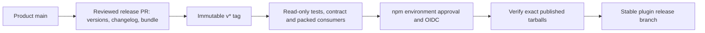

# Package releases

The app deploys from `main` through Vercel independently. Merging CLI code prepares a release;
`centrail sync` uploads usage and never publishes or installs the CLI.

1. Merge product PRs with Conventional Commit titles. Release Please proposes versions and
   notes for `feat`/`fix`; test/docs/chore-only work does not trigger an unnecessary release.
2. Review the release PR's coordinated CLI/parser versions, Claude/Codex metadata, marketplace,
   changelog and rebuilt bundle. Require platform checks and parser comparisons before merge.
3. Merging that release PR creates an immutable `v*` tag. The workflow explicitly dispatches
   publication at the tag ref because GitHub suppresses token-created tag push events.
4. Read-only CI tests the tagged code and deployed server contract, then retains tested tarballs.
   After `npm` approval, OIDC publication installs no dependencies and runs no build/tests.
5. Publish parsers before CLI, verify both registry tarballs against retained bytes, then advance
   the stable plugin's `release` branch. That branch is an update pointer, never a publish trigger.
   `release-pointer-guard` checks hourly (from `main`) and on every push that `release` is a `v*`
   tag commit on `main`, and opens an issue mentioning the maintainers if it is not.

Stable versions use npm `latest`; prereleases use `next` and leave the stable plugin unchanged.
A prerelease needs a reviewed version PR first. Tags must match coordinated versions on main.
Publishing uses GitHub-hosted Node 24/npm 11.5.1+; installed CLI support remains Node 20+.

For interruption recovery, rerun the failed tag workflow or dispatch `publish.yml` at that
existing tag. Matching immutable versions are verified and reused; mismatches fail. Never
recreate a published tag/version or move a channel backward. This process does no historical
repricing. Users upgrade their installation, then normal sync replays eligible local history.

## One-time owner settings

- Enable GitHub Actions to create pull requests. GitHub combines creation and approval in
  one checkbox; this workflow creates PRs and leaves approval to humans. Require green main checks.
- Protect published `v*` tags against updates/deletion, keeping intended tag creation permitted.
- Protect environment `npm` with a reviewer and prevent self-review. Set deployment policy
  **type tag**, pattern `v*`; a branch rule with that text does not admit version tags.
- Configure trusted publishing for **both** `centrail` and `@centrail/parsers`: owner
  `braydenyancy`, repository `centrail-cli`, workflow `publish.yml`, environment `npm`.
  Allow direct `npm publish` and `npm dist-tag`. No long-lived npm token fallback is used.
- Create fresh npm trust shortly before publication; first use currently must be within two days.
  Verify OIDC works before retiring old automation tokens.
- Keep the repository public and package repository metadata aligned for provenance.

Owner settings and a real publication require external verification; local checks do not prove them.
The manifest records the last release and advances through the reviewed release PR.
Local development identifiers do not reserve npm versions; the receipts record the first proposal.

Run `npm run verify`; optional SDK commands are in [verification](verification.md).
Receipts: [actual SDK rehearsal](verification/release-automation-2026-10-12.json),
[toolchain verification](verification/release-toolchain-2026-10-12.md).
Sources: [Release Please](https://github.com/googleapis/release-please-action),
[GitHub event triggering](https://docs.github.com/en/actions/how-tos/writing-workflows/choosing-when-your-workflow-runs/triggering-a-workflow),
[npm trusted publishing](https://docs.npmjs.com/trusted-publishers/).
