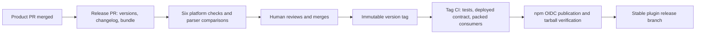

# Package releases

Merging product code does not install a new CLI for users. The website deploys independently;
packages are published by CI from an immutable `v*` tag after a reviewed release PR.



Release Please tracks one version for both packages, the Claude/Codex plugin metadata and the marketplace. Its baseline is the
actually published `0.7.3`, not the unpublished `0.7.5-account-local.0` development version.
Conventional `feat`/`fix` commits propose a release; test/docs/chore-only commits do not.
The candidate package fields are normalized to `0.8.0`; the SDK rehearsal proposes that same
version. This avoids the generic updater retaining part of the older multi-hyphen prerelease.
The manifest/version.txt stay at the published baseline until the release PR is reviewed.

The workflow rebuilds the committed plugin bundle on the release branch and explicitly
dispatches CI/comparisons. GitHub suppresses tag push workflows when its built-in token creates
a tag, so Release Please explicitly dispatches `publish.yml` **at that tag ref**. Publication
from a branch is rejected. A human-created tag still triggers the same workflow normally.
No personal access token or release-bot key is required.

Stable versions publish under `latest`; prerelease versions publish under `next` and never
advance the stable plugin branch. A prerelease requires a reviewed version PR first; this
MVP does not create a second automatic prerelease branch. The read-only preparation job requires the tag's
commit to be in main history, all version fields to agree, a clean rebuilt bundle, the full
deployed-server contract, and packed-consumer checks. The credentialed job installs no dependencies, builds nothing and runs no tests. It downloads
the retained tested tarballs and minimal publisher helpers, checks them against the tag, and
rechecks the public server contract after approval. It publishes parsers before CLI and
compares both public registry tarballs to the exact retained tarballs before advancing
`release`. A retry accepts an existing version only if its integrity and downloaded bytes
match; mismatches fail. A newer registry channel is never moved backward by an old retry.

## One-time owner settings

- Enable Actions to create pull requests in the GitHub repository.
- Create GitHub environment `npm` with a reviewer, prevent self-review, and a **tag**
  deployment policy `v*` (not a branch rule). Keep that approval before publication.
- For **both** npm packages (`centrail` and `@centrail/parsers`), configure trusted publisher:
  owner `braydenyancy`, repo `centrail-cli`, workflow `publish.yml`, environment `npm`.
  Permit direct `npm publish` and `npm dist-tag` actions. No `NPM_TOKEN` fallback is used.
- Keep the repository public and package repository metadata aligned for provenance.

The workflow uses GitHub-hosted Node 24/npm 11.5.1+ for publishing while the CLI continues to
support Node 20. Owner settings and a real publication are external checks: local tests cannot
prove them. After an interrupted publish, rerun the failed tag workflow or dispatch
`publish.yml` selecting the existing tag; never delete/recreate a published tag or version.

## Credential boundary decision

The estate auth atlas §2 row 7/§14 and D40 describe GitHub OIDC into OpenBao for infrastructure
provisioning. This publisher talks directly to npm's external OIDC verifier; it does not use
OpenBao, Zitadel, an estate CI role or human pairing credentials. Existing estate flows are
unchanged. The old workflow used the long-lived `NPM_TOKEN`; the replacement permits only
GitHub's scoped workflow token plus npm's short-lived environment-bound credential. npm's
owner-side trust settings remain unverified until configured and exercised.

Sources: [Release Please](https://github.com/googleapis/release-please-action),
[GitHub event triggering](https://docs.github.com/en/actions/how-tos/writing-workflows/choosing-when-your-workflow-runs/triggering-a-workflow),
[npm trusted publishing](https://docs.npmjs.com/trusted-publishers/).

## Repeatable preparation checks

`npm run verify` now includes the release-policy tests and offline installation of both
packed consumers. CI repeats those checks on Node 20/24 across Linux/macOS/Windows. Release
policy tests reject branch events, malformed semver, version drift and immutable retry mismatches.

To rehearse the actual pinned Release Please SDK without creating a PR, tag or release:

```text
npm install --prefix .release-artifacts/release-sdk --ignore-scripts --no-audit --no-fund release-please@17.3.0
npm run release:rehearse -- <absolute SDK package directory> braydenyancy/centrail-cli <absolute checkout directory> <absolute disposable output directory>
```

The SDK package directory is `.release-artifacts/release-sdk/node_modules/release-please`.
The helper uses the existing `gh` login in memory for read-only GitHub history calls. It overlays
candidate main-file reads with the local checkout and applies the SDK's real file updaters only
to the disposable output directory. It writes the proposed PR/version/files as `receipt.json`.
This is a preparation rehearsal, not proof that owner-side settings permit a real publication.

Merged PRs without Conventional Commit squash titles may supply Release Please's supported
`BEGIN_COMMIT_OVERRIDE` / `END_COMMIT_OVERRIDE` body block. This records intended release notes
without rewriting history; PR15 uses that correction so the collection changes appear in0.8.0.

The verification toolchain uses Vitest 4.1.11 and Vite 6.4.3 to retain Node 20.0 support;
newer Vite majors raise the minimum Node 20 minor. The root Vite override is intentional.
Toolchain upgrades require rebuilding and reviewing the committed plugin bundle.
